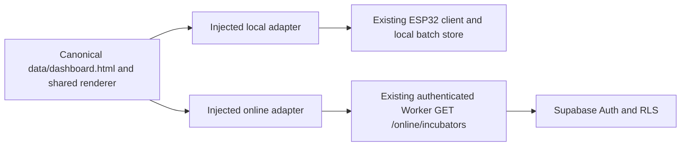

# Sprint 1 — shared local and online dashboard

Status: local implementation and automated acceptance verification complete.
No firmware, NVS, SPIFFS image, camera, cloud configuration or deployment changes
were performed in this sprint. Real-user verification of the newly mounted shared
UI and physical ESP32 testing remain unperformed. Prior screenshots verified the
existing deployed Worker lookup, not this new dashboard UI.

## Inspection and implementation plan

`data/dashboard.html` is the canonical layout. Its stylesheet links, local fonts,
logo, cards, navigation and canvas renderer are reused. `dashboard.js` previously
registered one DOMContentLoaded callback and accessed HatchEspApi/HatchBatchStore
directly. `getData()` can synchronize local time and import device batch records;
those are local behaviors, not cloud reads. `authSession.js` automatically starts
local session checks. `camera.js` uses private HTTP preview addresses. These
scripts cannot simply be pointed at a Worker.

The existing online login verifies Supabase sessions in memory. The only online
data endpoint used in this sprint is GET /online/incubators. No telemetry,
history, batch, prediction, camera or actuator endpoint was invented.

The implementation sequence was: adapter contract and unit tests; explicit shared
initialization; authenticated online mounting; deterministic asset packaging;
mocked browser, local regression and security checks. No backend blocker required
a schema change. Online feature limitations are deliberately explicit.

## Architecture and ownership



- `data/js/dashboardAdapters.js`: explicit local/online factories; no environment
  detection, network request or storage access on load. Local methods delegate
  unchanged to the existing API and batch store. Online methods accept token/read
  callbacks, return honest unavailable states and reject local commands.
- `data/js/dashboard.js`: injected adapter, original local renderer/chart logic,
  explicit unavailable online rendering, one active instance, listener disposal,
  bounded polling and rejection of late completions after disposal.
- `data/js/dashboard-local.js`: DOMContentLoaded bootstrap for the local page.
  Existing ESP32 authentication and notification pairing scripts remain local.
- `public/online-dashboard.js`: mounts generated canonical markup after login in
  the same document. It imports only shared app/adapter/renderer code. It does not
  import local authSession, espApi, batchStore, camera or pairing code.
- `public/online-login.js`: reuses the verified account and incubator result;
  passes only in-memory token access to the online adapter. Existing sign-out,
  password handling and local Worker test mode are preserved. Session controls
  are moved, not duplicated, into the shared dashboard and restored on sign-out.
- `public/online-api-settings.js`, `supabase-auth.js`, `incubator-read.js` remain
  the existing configuration, authentication and bounded Worker read transport.

Online view data is a browser-only contract, not a claimed server schema. It
contains the verified incubator list, unavailable feature descriptors, and a null
synchronization timestamp. Missing measurements are never zero, OFF or fabricated
history. Incubator refresh is not evidence of sensor freshness. Online prediction
does not invoke the ESP32 prediction endpoint. Cloud navigation exposes only the
supported dashboard; adapter rejection is independent of hidden UI links.

Local polling remains five seconds. Online account refresh is sixty seconds,
pauses while hidden and avoids overlap. Individual reads use the existing bounded
request timeout. Sign-out removes listeners/timers and prevents late responses
from restoring a dashboard. Tokens remain in memory, with no URL, console or
browser-storage persistence. Reload still requires sign-in.

## Packaging and keeping the two targets synchronized

From the repository root:

```powershell
node tools/package-online-dashboard.mjs
```

The script writes generated assets under `public/shared/` (ignored in Git):
eleven byte-identical shared assets, one generated HTML fragment and a SHA-256
manifest. The fragment comes directly from data/dashboard.html; local scripts
are omitted and shared image/CSS paths are adjusted. No framework or CDN is used.
The output path is fixed and files are explicitly allowlisted. Unexpected output
files and symbolic links cause failure; existing unknown files are not deleted.
The script never recursively copies public/, credentials or development config.

Run packaging after canonical dashboard edits and before a future Hosting build.
Do not manually edit generated files. Local source continues to use its own
bundled files and never depends on cloud-hosted assets. Nothing changes on the
physical ESP32 until a separately authorized filesystem upload.

The generated directory is only the shared asset subset, not a standalone site:
the existing public/ login, auth and configuration files remain the cloud entry.
No Firebase Hosting configuration change is necessary for this local review.

## Changed files

Created:
- data/js/dashboardAdapters.js — local and online contract implementations.
- data/js/dashboard-local.js — explicit local bootstrap.
- public/online-dashboard.js — authenticated same-document mounting.
- tools/package-online-dashboard.mjs — deterministic allowlisted generation.
- test/dashboard-adapters.test.mjs — adapter isolation and command rejection.
- test/local-session-regression.test.mjs — accepted/rejected local login.
- test/shared-dashboard-package.test.mjs — reproducibility, hashes, exclusions.
- test/shared-dashboard-browser.cjs — mounted UI, authentication lifecycle,
  unavailable features, network isolation, disposal and responsive checks.
- docs/SHARED_DASHBOARD_SPRINT1.md — this report.

Modified:
- data/dashboard.html — load shared adapter/renderer and local bootstrap.
- data/js/dashboard.js — injectable initialization and online rendering.
- data/js/app.js — expose existing navbar initializer and listener cleanup.
- public/online-login.html — scoped login styles, shared host and refresh control.
- public/online-login.js — mount/destroy dashboard with the existing session.
- .gitignore — ignore generated public/shared assets; preserve existing rules.

No CSS file, espApi, batchStore, local auth, control, camera, Worker or firmware
source was changed in this sprint. Existing unrelated working-tree edits remain.

## Verification performed

All browser/device/provider interactions below used mocks; no live user
credentials, real actuators, cloud writes or push deliveries were used.

```powershell
node --test test/dashboard-adapters.test.mjs test/shared-dashboard-package.test.mjs test/local-session-regression.test.mjs test/incubator-read.test.mjs test/online-auth.test.mjs
node test/shared-dashboard-browser.cjs
node test/online-auth-browser.cjs
$env:HATCH_PLAYWRIGHT_MODULE = 'C:/Users/LENOVO/AppData/Roaming/npm/node_modules/@playwright/cli/node_modules/playwright-core'
node test/ui-regression.cjs
node test/recovery-ui.cjs
node test/control_dual_motor_test.cjs
node test/camera-push.cjs
npm --prefix cloudflare-worker test
```

Results:
- 23 unit/packaging/session tests passed; zero failures.
- Shared online browser: 50 checks passed.
- Existing online login: 29 checks passed.
- Existing local UI: 152 checks passed (readings, history, predictions, batches,
  navigation, controls, Wi-Fi and calibration).
- Existing recovery UI: 50 checks passed.
- Existing dual-motor client regression passed.
- Existing camera preview/provider mocks passed; delegated notification-browser
  suite passed 47 checks. No live notifications were enabled or sent.
- Existing Worker suite: 92 tests passed; zero failures.
- JavaScript syntax and changed-file whitespace checks passed.
- Generated files matched canonical asset hashes, and two builds matched.
- Desktop/mobile screenshots inspected under dist/sprint1-review/.

## Resource review and limitations

At verification, data/ totaled 397,045 bytes, a 7,210-byte increase attributable to
this sprint versus its inspected baseline. Dashboard HTML: 7,426 bytes. Scripts
loaded by the local dashboard: 65,973 bytes. All local JavaScript totals 162,271
bytes, and all CSS totals 47,477 bytes. Images remain below 40 KB each. The shared
cloud output is approximately 180 KB including its manifest.

The existing whole-site 350 KB and all-JavaScript 80 KB engineering targets were
already exceeded before this sprint. No unrelated feature was removed to meet
them. The dashboard's own script set remains below 80 KB. Raw asset totals do not
prove filesystem capacity: no SPIFFS image was rebuilt or uploaded, preserving
the user's existing artifact. A separately authorized filesystem packaging check
is still required before a physical filesystem update.

The firmware artifact remains 1,310,672 bytes with SHA-256:
FE836BEBF3799713FD8F2194DA83327BF97B883C5F0922161FA6163B5CA28C84.
Its 48-byte application headroom is unchanged. No firmware build was needed.

## User review and next increment

Keep the existing local static server running. Open:
http://127.0.0.1:8080/online-login.html
Hard-refresh and sign in privately. The same dashboard should mount and show
authorized incubators, with monitoring unavailable. For the existing local
Worker server use ?worker-test=1; that mode is explicitly loopback-gated and is
not production verification.

This update has not been deployed to Firebase Hosting or flashed to the ESP32.
Real-user verification of the new UI is the immediate next step. Then review one
telemetry read/write schema and authenticated synchronization design separately;
do not activate placeholder features or public hardware-control APIs.
